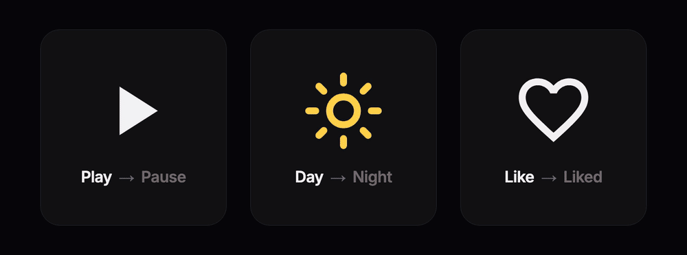

<p align="center">
  <a href="https://www.morphicons.com">
    <picture>
      <source media="(prefers-color-scheme: dark)" srcset="assets/logo-dark.svg">
      
    </picture>
  </a>
</p>

<h1 align="center">morphicons</h1>

<p align="center">
  <a href="https://www.morphicons.com"><strong>morphicons.com</strong></a> — live playground
</p>

<p align="center">
  <a href="https://github.com/sponsors/guillermolg00">
    
  </a>
</p>

<p align="center">
  
</p>

Morph any SVG icon into any other, stroked or filled, with spring physics. Lucide, Tabler, Heroicons, Material Symbols, Phosphor or your own paths. Zero runtime dependencies.

```tsx
import { MorphIcon } from "morphicons/react";
import { Menu, X } from "lucide"; // icon data, not components

<MorphIcon icon={open ? X : Menu} />
```

Change the prop and the icon morphs. Nothing to configure.

## Install

```bash
npm install morphicons
```

Icons are **data**: an `IconNode` (Lucide's format) or a `d` string. For Lucide, import from `lucide`, not `lucide-react`.

| entry | |
|---|---|
| `morphicons/react` · `vue` · `svelte` · `react-native` | `<MorphIcon>` (the framework peer is optional) |
| `morphicons/astro` · `element` | Astro component · `<morph-icon>` for plain HTML |
| `morphicons/dom` | `createMorph()`, no framework |
| `morphicons/adapters` | `svgToIcon`, `maskTarget`, `canvasTarget` |
| `morphicons` | the pure core, no DOM |

## Usage

Three modes, the same in every binding:

```tsx
<MorphIcon icon={open ? X : Menu} />             // 1. change the prop: it animates
<MorphIcon from={Menu} to={X} progress={0.4} />  // 2. you drive the progress
<MorphIcon ref={ref} icon={Menu} />              // 3. ref.current.morphTo(X), or set(X) to jump
```

| prop | |
|---|---|
| `size`, `color`, `strokeWidth`, `absoluteStrokeWidth` | as in lucide-react; other `<svg>` attributes pass through |
| `spring` | `"snappy"` (default), `"smooth"`, `"bouncy"` or `{ stiffness, damping }` |
| `reducedMotion` | `"never"` (default), `"user"` (follow the OS) or `"always"` |
| `label` | accessible name; without it the icon is `aria-hidden` |

SSR renders the final SVG, so nothing flashes on hydration.

### Lifecycle contract

- Mounting without an icon is fine; the first one appears without animating.
- While `from` and `to` are set, they win over `icon`.
- Leaving controlled mode and coming back renders like a fresh mount.

### Other frameworks

```vue
<MorphIcon :icon="open ? X : Menu" />   <!-- Vue 3 -->
```

```svelte
<MorphIcon icon={open ? X : Menu} />    <!-- Svelte 5 -->
```

React Native has the React API (it needs Metro with package `exports`, the default since 0.79). Astro renders the SVG on the server and upgrades it to a `<morph-icon>` element in the browser. In plain HTML, use the element directly:

```html
<script type="module">
  import { defineMorphIcon } from "morphicons/element";
  defineMorphIcon();
</script>

<morph-icon icon="M4 6h16M4 12h16M4 18h16" label="Menu"></morph-icon>
```

Without a framework:

```ts
import { createMorph } from "morphicons/dom";

const m = createMorph(pathEl, Menu); // an SVG <path>
m.morphTo(X);
```

## Fill icons

When either icon is filled, both morph as filled shapes. The code for that (5.4 KB gzip) loads the first time a filled icon shows up; stroke-only apps never download it. To bundle it instead:

```ts
import { setRegionLoader } from "morphicons/dom";
import * as region from "morphicons/region";

setRegionLoader(async () => region);
```

Or call `preloadRegion()` early to fetch it before the first morph. For long lists of filled icons on low-end devices, run `toRegion(icon)` from `morphicons/region` at build time: the driver uses its output as is, with no normalization at runtime.

## Format adapters

- `svgToIcon(markup)`: SVG markup (an Iconify body, a full `<svg>`) to an icon.
- `maskTarget(el)`: morphs CSS-mask icons in place (UnoCSS, Tailwind icon plugins).
- `canvasTarget(canvas)`: draws the morph into a canvas or 2D context.

```ts
createMorph(maskTarget(span), svgToIcon(markup));
```

`maskTarget` and `canvasTarget` draw strokes only.

## Icon library compatibility

Any set on a 24×24 grid works as is. For other grids, use `fitIcon(icon, 32)` from `morphicons`, or `svgToIcon`, which reads the `viewBox`.

## How it works

For each pair of shapes, morphicons solves the rotation, scale and translation that best map one onto the other, in closed form, and interpolates each separately. Two icons that are the same shape rotated simply rotate. Details in [docs/how-it-works.md](docs/how-it-works.md), decisions in [docs/adr](docs/adr).

## Size

gzip, enforced in CI: core 6.7 KB, `dom` 9.3, `react` 10.2, `vue` 10.3, `svelte` 9.9, `element` 11.1, `react-native` 15.9. The fill code adds 5.4 on first use. Adapters: 0.5–4.2 each.

## Development

```bash
bun install
bun test && bun run typecheck && bun run lint
bun run play   # playground → http://localhost:3000
```

Playground icons: [Lucide](https://lucide.dev) (ISC), [Feather](https://feathericons.com) (MIT), [Tabler](https://tabler.io/icons) (MIT).

---

MIT © [Guillermo](https://guillermolg.com) — made by [guillermolg.com](https://guillermolg.com)
